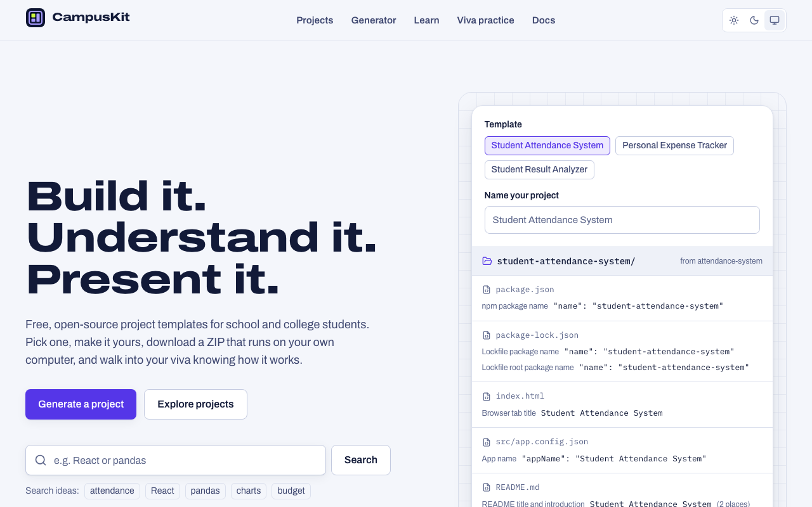
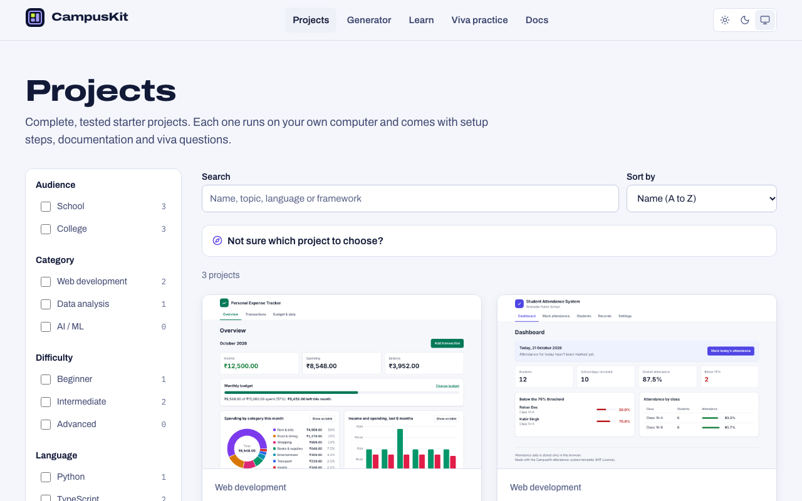
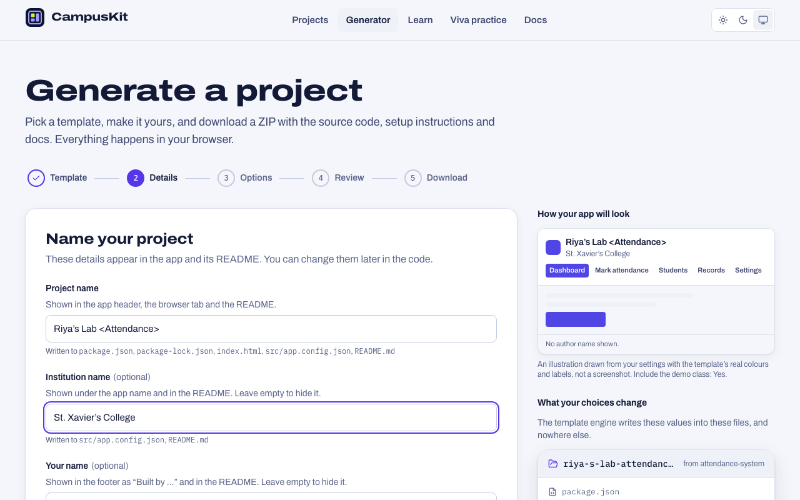
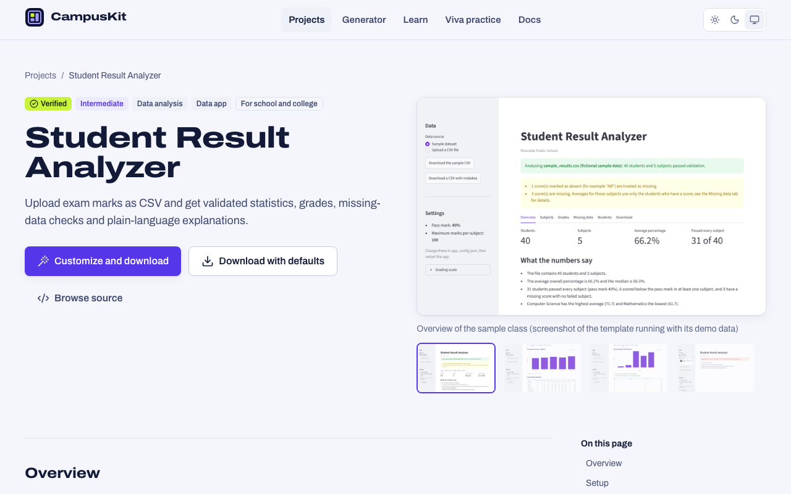
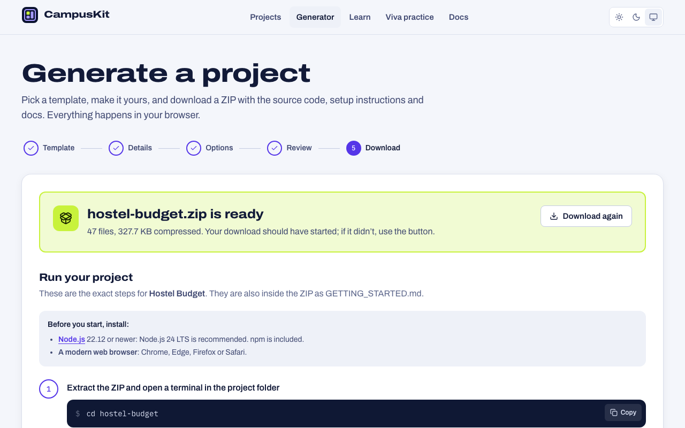
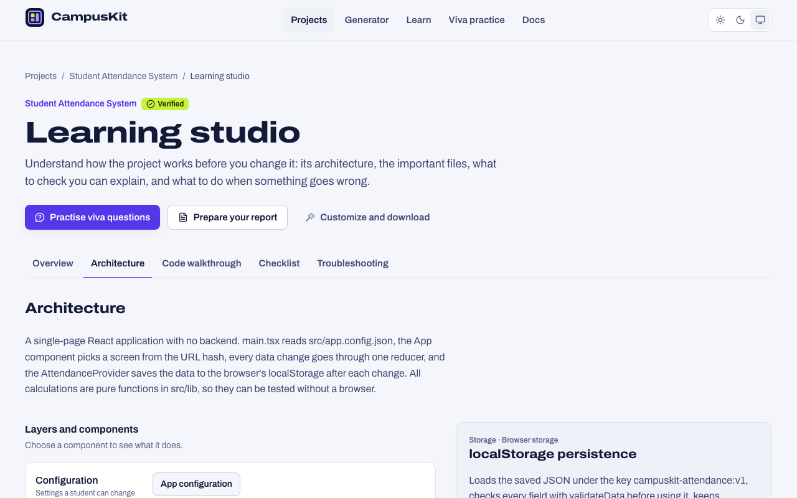
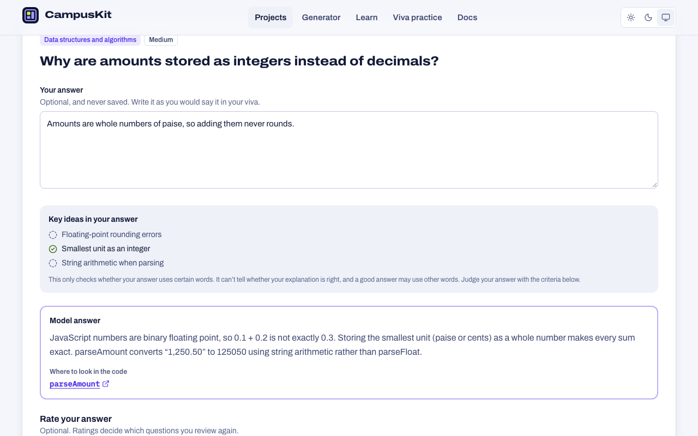
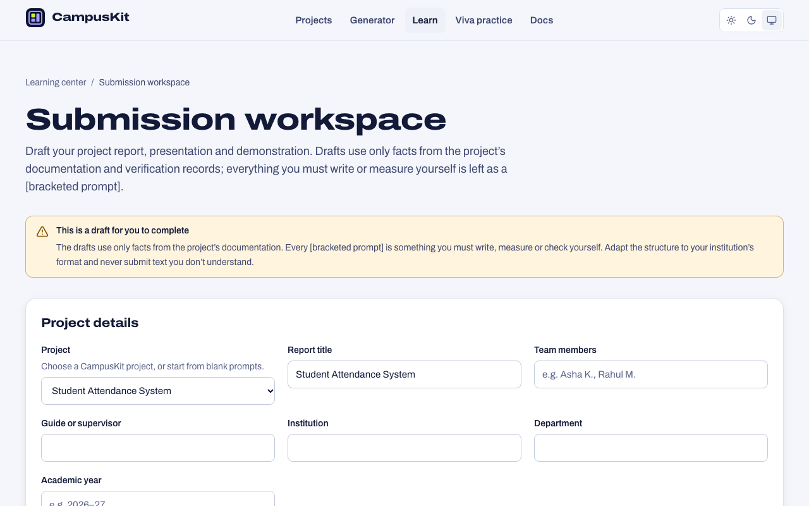
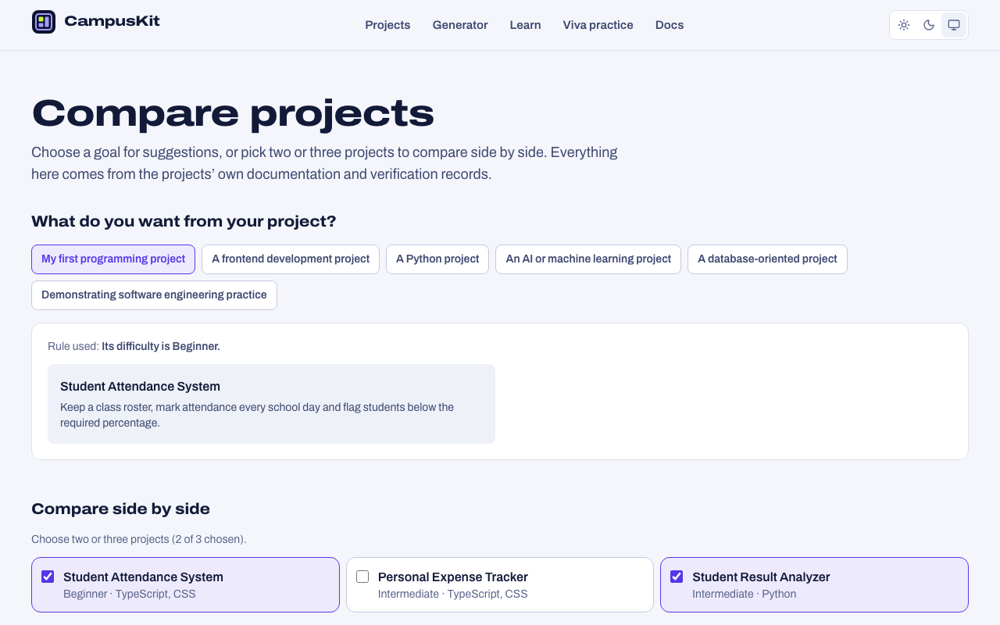
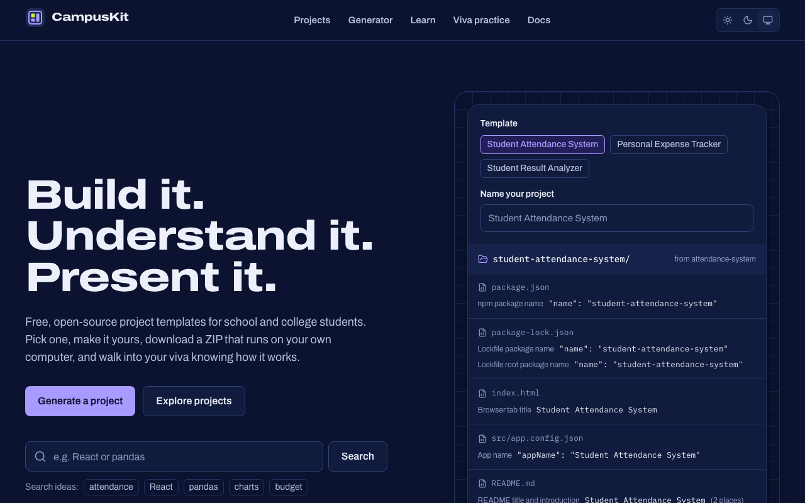

<picture>
  <source media="(prefers-color-scheme: dark)" srcset="docs/brand/wordmark-dark.svg">
  
</picture>

**Build it. Understand it. Present it.**

CampusKit is a free, open-source project factory and learning studio for school and college students. Pick a complete starter project, customize it in your browser, download a ZIP that runs on your own computer, learn how it works, practise explaining it for your viva and prepare your report.

It is a static website: no accounts, no server, no database and no AI service. Projects are generated in the browser, learning progress is saved only in the student's own browser, and nothing a student types leaves their computer.



## What's included

**Three complete templates**, each with a README, architecture notes, viva questions, real screenshots, sample data, automated tests and an MIT licence:

| Template                                                     | Stack                           | Level        | What it does                                                                             |
| ------------------------------------------------------------ | ------------------------------- | ------------ | ---------------------------------------------------------------------------------------- |
| [Student Attendance System](templates/attendance-system)     | React, TypeScript, localStorage | Beginner     | Class roster, daily attendance, percentages per student and class, CSV export            |
| [Personal Expense Tracker](templates/expense-tracker)        | React, TypeScript, Recharts     | Intermediate | Income and expenses, monthly budget, charts with table alternatives, CSV and JSON export |
| [Student Result Analyzer](templates/student-result-analyzer) | Python, pandas, Streamlit       | Intermediate | Validates a marks CSV, computes statistics, grades and ranks, exports a report           |

**A website** with:

- a **project gallery** with search and filters (audience, category, difficulty, language, type) that live in the address, so a filtered view can be shared, and a short guide that compares projects on what they need: what to install, setup steps, whether they run offline, and API keys;
- **project pages** with screenshots, features, limitations, prerequisites, setup and test commands, customization options, verification results, documentation, viva questions and related projects;
- a **generator** that validates your choices, shows exactly which files they change, lets you read the generated files before downloading, and builds the ZIP in your browser together with a `GETTING_STARTED.md` (setup steps, environment variables, known limitations) and a project report draft for that project;
- a **verification status** for every template (Verified, Awaiting verification, Needs attention or Draft), backed by recorded runs of `pnpm verify:generated` and tied to a fingerprint of the exact files the site serves, so a badge can't outlive the code it describes;
- a **learning studio** for every project: an architecture explorer (layers, components, connections and data flows), a walkthrough of the important files with links that open the source browser at each function's definition, a checklist of what to be able to explain, and troubleshooting for the project's own stack, with problems actually seen during verification marked as such;
- **viva practice** with quick, topic, mixed and review modes: write your answer, compare it with a model answer based on the code, see which key ideas your answer mentions (a transparent word check, not an assessment), and rate yourself on four criteria;
- a **submission workspace** that drafts every report section from the project's real features and limitations, keeps CampusKit's facts and verification results in a labelled appendix apart from what you write, and adds a demonstration checklist and a presentation outline you can copy as a slide list;
- a **comparison page** that puts two or three projects side by side and suggests projects for goals such as “my first project” or “a Python project” using written rules over the projects' own data;
- **documentation** for students and contributors.

| Gallery                                                                                                                          | Generator                                                                                                                                |
| -------------------------------------------------------------------------------------------------------------------------------- | ---------------------------------------------------------------------------------------------------------------------------------------- |
|               |  |
| **Project page**                                                                                                                 | **Ready to download**                                                                                                                    |
|                    |                      |
| **Learning studio**                                                                                                              | **Viva practice**                                                                                                                        |
|  |          |
| **Submission workspace**                                                                                                         | **Compare projects**                                                                                                                     |
|                                     |                                           |
| **Dark theme**                                                                                                                   |                                                                                                                                          |
|                                                                |                                                                                                                                          |

## Quick start

You need [Node.js](https://nodejs.org/) 22.12 or newer (24 LTS recommended) and pnpm 10:

```bash
npm install --global pnpm@10.34.7   # or: corepack enable
pnpm install
pnpm dev
```

Open <http://localhost:5173/>. To try the production build, run `pnpm build` and then `pnpm preview` (<http://localhost:4173/>).

Students don't need any of this: they use the website, download a project and follow its `GETTING_STARTED.md`. The guides in [docs/guides](docs/guides) explain how to [run a React project](docs/guides/run-a-react-project.md) and [run a Python project](docs/guides/run-a-python-project.md).

## Commands

| Command                               | What it does                                                                                 |
| ------------------------------------- | -------------------------------------------------------------------------------------------- |
| `pnpm dev`                            | Starts the website with hot reloading on port 5173                                           |
| `pnpm build`                          | Builds the static site into `apps/web/dist`                                                  |
| `pnpm preview`                        | Serves the production build on port 4173                                                     |
| `pnpm test`                           | Runs the unit and component tests of the engine, the catalog, the website and the repository |
| `pnpm test:e2e`                       | Builds the site and runs the Playwright tests in Chromium, at desktop and phone sizes        |
| `pnpm playwright:install`             | Downloads the Chromium build that Playwright uses (once)                                     |
| `pnpm lint`                           | ESLint with TypeScript, accessibility (jsx-a11y) and React hooks rules                       |
| `pnpm typecheck`                      | TypeScript in strict mode, for every package                                                 |
| `pnpm format` / `pnpm format:check`   | Formats, or checks the formatting of, every file with Prettier                               |
| `pnpm validate`                       | Validates the catalog against the templates and runs the repository checks                   |
| `pnpm verify:generated`               | Generates every template, extracts it, installs it, and runs its tests and build             |
| `pnpm verify:generated <id> --record` | The same for one template, then saves the result as its verification record                  |
| `pnpm changed-templates [base]`       | Lists the templates a branch changed (CI uses it to verify only those on pull requests)      |
| `pnpm screenshots`                    | Captures the screenshots of the templates and the website from the real apps                 |
| `pnpm check`                          | Runs validate, format:check, lint, typecheck, test and build in order                        |

`pnpm verify:generated` needs Python 3.11 or newer for the Python template. Set `CAMPUSKIT_PYTHON` to choose the interpreter. The screenshot and verification scripts use Playwright's Chromium, or the browser in `CAMPUSKIT_CHROMIUM` if you set it.

## How it works

```text
packages/project-catalog/manifests/*.json ──▶ gallery, project pages, generator form, report builder
templates/<id>/ ──(Vite plugin)──▶ template bundle (JSON) ──▶ template engine in the browser ──▶ ZIP
```

Every template has a **manifest**: a JSON file that describes the project and declares its customization options, and, for each option, the exact files and locations it changes. The **template engine** validates the student's values, writes them only to those declared locations (escaped for HTML, Markdown, TOML or JSON as needed), refuses unsafe paths, leaves out dependencies, build output, caches and secret files, adds `GETTING_STARTED.md` and `docs/PROJECT_REPORT_DRAFT.md`, and packages everything into a ZIP with a single root folder. It never runs template code.

## Template verification

The catalog checks run on every build: a template that fails them is never published. A full verification goes further: `pnpm verify:generated <id> --record` generates the project with the default settings and with every setting changed, extracts each ZIP, installs the dependencies and runs the tests and the build or app, then writes `packages/project-catalog/verification/<id>.json` with the date, operating system, tool versions and every step that ran.

Each record stores a fingerprint of the template files and of the manifest settings that affect them. The website computes the same fingerprint from the files it publishes and shows a template as **Verified** only when they match a passing record. Editing a template therefore returns it to **Awaiting verification** until someone runs the script again; a failed run shows **Needs attention**. The project page lists every recorded run, and which operating systems have not been verified.

Read more in [Architecture](docs/architecture.md) and [Template engine](docs/template-engine.md).

## Repository layout

```text
apps/web/                  The website (React, TypeScript, Vite, Tailwind CSS, React Router)
packages/template-engine/  Options, edits, escaping, path safety and ZIP files
packages/project-catalog/  Manifests, their Zod schema, verification records and the catalog validator
templates/                 The starter projects, exactly as students receive them
scripts/                   Repository checks, generated-project verification, screenshots
tests/                     Repository-level tests
docs/                      Guides for students and documentation for contributors
.github/                   CI and deployment workflows, issue and pull request templates
```

## Quality checks

- **Template engine:** escaping in every context, edits, Unicode names, path traversal and reserved names, secret and build-output exclusion, ZIP structure.
- **Catalog:** every manifest is validated with Zod, and every declared edit is applied to the real template with the default values and with a name full of special characters and Unicode.
- **Website:** component tests render the real routes with the real templates, including a full generation whose ZIP is inspected; axe-core checks every page type.
- **End to end:** Playwright tests the production build in Chromium at desktop and phone sizes. They download and inspect real ZIP files, check keyboard navigation and the mobile menu, fail on any console error, failed request or Content Security Policy violation, and run axe with every rule, including colour contrast, in both themes.
- **Generated projects:** `pnpm verify:generated` extracts each generated ZIP safely, checks the customized and excluded files, then installs the project and runs its own tests and build.

The CI workflow in [.github/workflows/ci.yml](.github/workflows/ci.yml) runs all of these on every push and pull request. The generated-project verification runs on Linux, Windows and macOS: for every template on pushes to `main`, and for pull requests only for the templates the change touches (a change to the engine or catalog code still verifies every template).

## Adding a template

A template is a working project in `templates/<id>/` plus a manifest in `packages/project-catalog/manifests/`. Follow [Adding a template](docs/adding-a-template.md) and the [new project checklist](docs/new-project-checklist.md). `pnpm validate:catalog` tells you exactly what is missing.

## Deploying

The site is static. `pnpm build` produces `apps/web/dist`, which you can host on GitHub Pages (a workflow is included), Netlify (`netlify.toml` is included) or any static host with a single-page app fallback. See [Deployment](docs/deployment.md).

## Known limitations

- There are three templates. The AI and machine learning category has none yet, and the website says so instead of showing an empty promise.
- The generator changes only what each template declares: names, branding, theme colours, sample data and a few settings. It does not add features.
- Generated projects need Node.js or Python installed on the student's computer, and installing their dependencies needs an internet connection the first time.
- The React templates store data in the browser's `localStorage`, with no accounts or sync. They are learning projects, not systems for real institutional records.
- Report drafts, checklist ticks and viva ratings are saved only in the browser that wrote them, with no sync between devices. Drafts are prompts and facts to build on, not finished text, and nothing is exported as PDF or PowerPoint: the workspace downloads Markdown and copies a plain slide list.
- The key-idea check in viva practice only looks for words in the student's answer. It can't judge whether an explanation is correct; students rate themselves.
- Learning guides are written by people. The validator guarantees that every file and function they mention exists in the template, but the explanations themselves are checked by review, not automatically.
- Verification records are written on a maintainer's computer and committed. CI repeats the verification on three operating systems but does not write records, so the website shows only the platforms someone recorded.
- A record covers a template's files and its manifest settings. A change to the template engine itself is covered by CI, which verifies every template when the engine changes, rather than by the records.
- Automated browser tests run in Chromium only. The site uses standard web features and should work in current Firefox and Safari, but those browsers are not tested automatically.

## Contributing, security and licence

Contributions are welcome: see [CONTRIBUTING.md](CONTRIBUTING.md) and the [code of conduct](CODE_OF_CONDUCT.md). Report security problems privately as described in [SECURITY.md](SECURITY.md).

CampusKit and every template are released under the [MIT License](LICENSE). The licence lets you use, change and share the code as long as the copyright notice stays with it. It does not change your institution's rules about using templates in coursework: read [Using templates honestly](docs/guides/using-templates-honestly.md). Fonts, icons and libraries are listed in [THIRD_PARTY_NOTICES.md](THIRD_PARTY_NOTICES.md).
