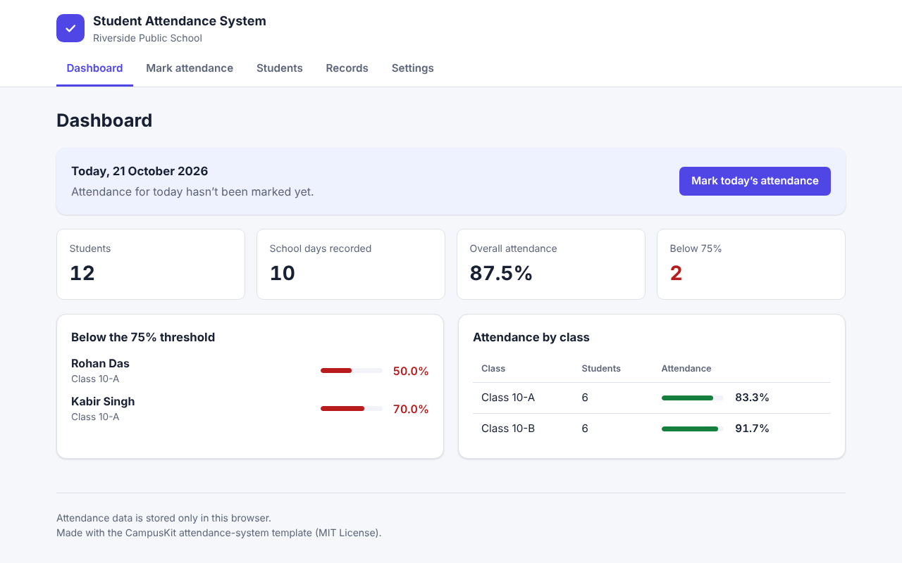
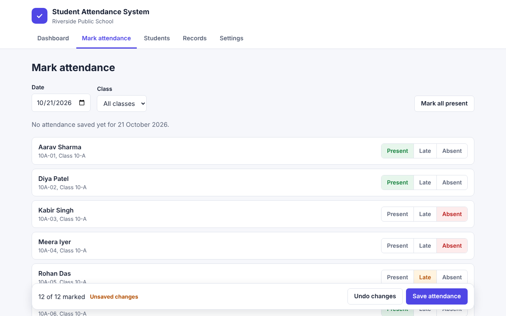
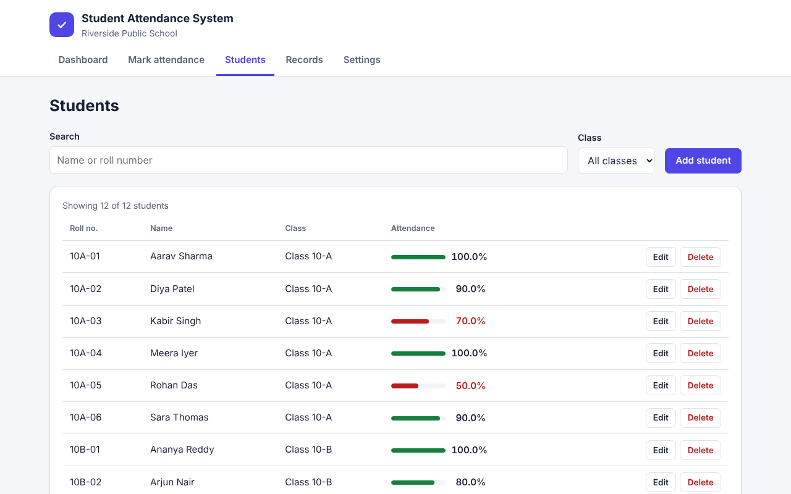

# Student Attendance System

Student Attendance System is a web app for keeping a class roster, marking attendance every school day and seeing who is falling below the required attendance percentage. It runs entirely in your browser: there is no server, no login and no database to set up.

| Project detail | Value                                        |
| -------------- | -------------------------------------------- |
| Institution    | Riverside Public School                      |
| Built by       | _Add your name_                              |
| Template       | CampusKit `attendance-system`, version 1.0.0 |
| Stack          | React 19, TypeScript, Vite, localStorage     |



## Features

- **Students:** add, edit and delete students with a roll number and class. Roll numbers must be unique within a class.
- **Mark attendance:** pick a date, mark each student Present, Late or Absent (or everyone present at once) and save. Saved dates can be reopened and corrected.
- **Records:** filter attendance by date range, class, status and student, see per-student totals for the period and export the records as CSV.
- **Dashboard:** today’s status, overall attendance, attendance by class and a list of students below the threshold.
- **Settings:** view the app configuration, export or import a JSON backup, load the demo class or delete all data.
- **Saved automatically** in the browser’s localStorage, with checks that recover safely from corrupted data.
- **Accessible:** keyboard-friendly navigation and dialogs, visible focus, labelled form fields and a dark theme that follows your system setting.

| Mark attendance                                                        | Students                                                                     |
| ---------------------------------------------------------------------- | ---------------------------------------------------------------------------- |
|  |  |

## Prerequisites

- **Node.js 22.12 or newer** (Node.js 24 LTS recommended). Check with `node --version`. Download it from <https://nodejs.org/>.
- npm, which is installed together with Node.js.
- A modern browser (Chrome, Edge, Firefox or Safari).

## Getting started

Open a terminal in this folder, then:

```bash
npm install
npm run dev
```

Vite prints a local address such as `http://localhost:5173/`. Open it in your browser. On the first run the app loads a fictional demo class so you can explore every screen.

| Command              | What it does                                           |
| -------------------- | ------------------------------------------------------ |
| `npm run dev`        | Starts the development server with live reload.        |
| `npm test`           | Runs the automated tests once.                         |
| `npm run test:watch` | Re-runs tests whenever you save a file.                |
| `npm run typecheck`  | Checks the TypeScript types without building.          |
| `npm run build`      | Type-checks and creates an optimised build in `dist/`. |
| `npm run preview`    | Serves the `dist/` build locally so you can check it.  |

`npm install` needs an internet connection the first time. After that the app works offline.

## Configuration

Edit `src/app.config.json`, then restart `npm run dev`:

| Setting               | Meaning                                                                            |
| --------------------- | ---------------------------------------------------------------------------------- |
| `appName`             | Name shown in the header and browser tab.                                          |
| `institutionName`     | Shown under the name. Leave empty (`""`) to hide it.                               |
| `authorName`          | Shown in the footer as “Built by …”. Leave empty to hide it.                       |
| `theme`               | Accent colour: `indigo`, `teal`, `rose` or `amber`.                                |
| `attendanceThreshold` | Students below this percentage are flagged (whole number, 1–100).                  |
| `seedDemoData`        | `true` loads the demo class when nothing has been saved yet; `false` starts empty. |

If the file contains a mistake, the app shows which setting is wrong instead of a blank page.

## How attendance is calculated

A student’s attendance percentage is **(days present + days late) ÷ days marked × 100**, rounded to one decimal place. Days on which a student was not marked at all (for example, before they joined) are not counted. Students with no marks show “No marks yet” rather than 0 %.

## Your data and how to reset it

Everything is saved in your browser’s **localStorage** under the key `campuskit-attendance:v1`. It never leaves your computer, and it is separate for each browser and browser profile.

- **Reset from the app:** open **Settings** and choose **Load demo data** or **Delete all data**. Use **Export backup (JSON)** first if you want to keep a copy.
- **Reset without the app:** open your browser’s developer tools (F12), go to **Application** (Chrome, Edge) or **Storage** (Firefox), open **Local Storage**, select the site (for example `http://localhost:5173`) and delete the `campuskit-attendance:v1` entry. Reload the page.

If saved data ever becomes unreadable, the app starts fresh and keeps the old value under `campuskit-attendance:v1:unreadable-backup`.

## Project structure

```text
src/
  app.config.json     Settings you can change without editing code
  config.ts           Reads and checks app.config.json, applies the theme
  types.ts            Data types (Student, AttendanceStatus, AttendanceData)
  main.tsx            Entry point: loads the config and renders <App>
  App.tsx             Header, navigation and the current view
  state/              Reducer and React context that hold the data
  views/              One component per screen (dashboard, students, ...)
  components/         Reusable pieces: dialogs, forms, badges, messages
  lib/                Plain functions: calculations, storage, dates, CSV
  test/setup.ts       Test environment setup
docs/
  ARCHITECTURE.md     How the parts fit together
  VIVA_QUESTIONS.md   Questions you may be asked about this project
  screenshots/        Images used in this README
```

Read [docs/ARCHITECTURE.md](docs/ARCHITECTURE.md) for the data flow and design decisions.

## Testing

```bash
npm test
```

The tests use Vitest, Testing Library and jsdom. They cover the attendance calculations, date handling, storage recovery, CSV escaping, form validation and the main user flows (adding and editing a student, marking attendance, searching and deleting).

## Known limitations

- Data lives in one browser on one device. There is no sync between devices or users, and clearing browser data deletes it (export a backup first).
- There are no user accounts or permissions; anyone using the browser can change the data.
- localStorage holds roughly 5 MB, which is plenty for a few classes over a school year but not for a whole institution.
- Attendance is recorded once per day; periods or subjects within a day are not tracked.
- Dates and names are shown in the browser’s language settings; the interface text itself is English only.

## License and credits

This project is released under the MIT License (see [LICENSE](LICENSE)). It was generated from the CampusKit `attendance-system` template. If you use it for coursework, follow your institution’s rules, mention that you started from a template, and make sure you can explain every part you present.
