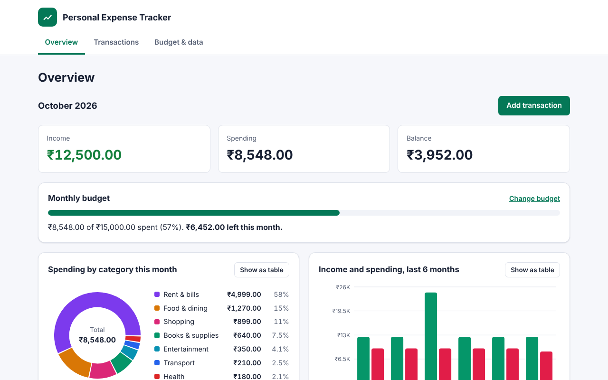
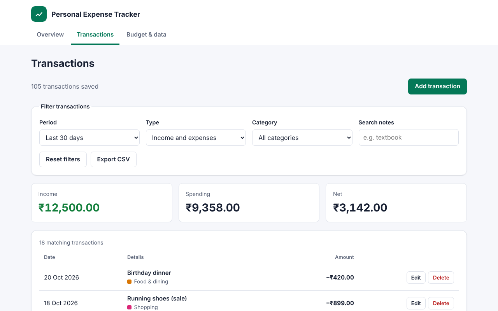
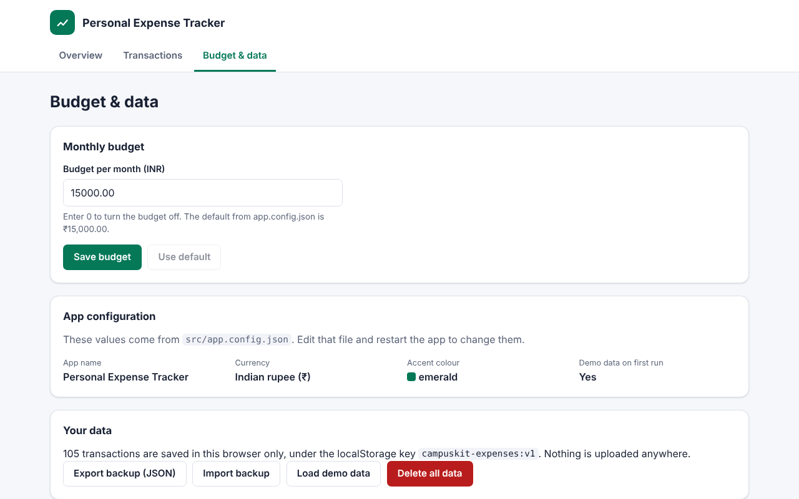

# Personal Expense Tracker

Personal Expense Tracker is a web app for recording what you earn and spend, setting a monthly budget and seeing where your money goes. Everything runs in your browser: there is no server, no account and no bank connection.

| Project detail | Value                                              |
| -------------- | -------------------------------------------------- |
| Built by       | _Add your name_                                    |
| Template       | CampusKit `expense-tracker`, version 1.0.0         |
| Stack          | React 19, TypeScript, Vite, Recharts, localStorage |



## Features

- **Transactions:** add, edit and delete income and expenses with an amount, category, date and optional note.
- **Categories:** eight spending categories (food, transport, rent & bills, books & supplies, shopping, entertainment, health, other) and five income categories.
- **Filters:** this month, last month, last 30 days, this year, all time or a custom date range; by type, by category and by note text. Totals update to match the filters.
- **Totals from real data:** income, spending and balance are calculated from the saved transactions every time; nothing is estimated.
- **Monthly budget:** a progress bar shows how much of the budget is used and how much is left (or how far over you are).
- **Charts:** spending by category (donut chart) and income vs spending for the last six months (bar chart). Each chart can be switched to a table with the same numbers.
- **Export:** download the filtered transactions as CSV for a spreadsheet, or the whole data set as a JSON backup that can be imported again.
- **Saved automatically** in localStorage, with validation that recovers safely from corrupted data.
- **Currency formatting** for INR, USD, EUR, GBP or JPY, including Indian digit grouping (₹1,50,000.00).

| Transactions                                                        | Budget and data                                                      |
| ------------------------------------------------------------------- | -------------------------------------------------------------------- |
|  |  |

## Prerequisites

- **Node.js 22.12 or newer** (Node.js 24 LTS recommended). Check with `node --version`. Download it from <https://nodejs.org/>.
- npm, which is installed together with Node.js.
- A modern browser (Chrome, Edge, Firefox or Safari).

## Getting started

Open a terminal in this folder, then:

```bash
npm install
npm run dev
```

Open the address Vite prints (usually `http://localhost:5173/`). On first run the app loads six months of fictional demo transactions so the charts have something to show.

| Command              | What it does                                           |
| -------------------- | ------------------------------------------------------ |
| `npm run dev`        | Starts the development server with live reload.        |
| `npm test`           | Runs the automated tests once.                         |
| `npm run test:watch` | Re-runs tests whenever you save a file.                |
| `npm run typecheck`  | Checks the TypeScript types without building.          |
| `npm run build`      | Type-checks and creates an optimised build in `dist/`. |
| `npm run preview`    | Serves the `dist/` build locally.                      |

`npm install` needs an internet connection the first time. After that the app works offline.

## Configuration

Edit `src/app.config.json`, then restart `npm run dev`:

| Setting         | Meaning                                                                                              |
| --------------- | ---------------------------------------------------------------------------------------------------- |
| `appName`       | Name shown in the header and browser tab.                                                            |
| `authorName`    | Shown in the footer as “Built by …”. Leave empty (`""`) to hide it.                                  |
| `currency`      | `INR`, `USD`, `EUR`, `GBP` or `JPY`. Changing it does not convert amounts you have already saved.    |
| `monthlyBudget` | Default monthly budget in whole currency units; `0` means no budget. You can override it in the app. |
| `theme`         | Accent colour: `emerald`, `ocean`, `plum` or `coral`.                                                |
| `seedDemoData`  | `true` loads demo transactions when nothing has been saved yet; `false` starts empty.                |

If the file contains a mistake, the app shows which setting is wrong instead of a blank page.

## How amounts are stored

Amounts are stored as whole numbers of the currency’s smallest unit, for example **paise** for rupees (₹12.50 is stored as `1250`). Adding whole numbers is exact, whereas decimal fractions in JavaScript are not (`0.1 + 0.2` is `0.30000000000000004`). Typed amounts are parsed with string arithmetic for the same reason. See `src/lib/money.ts`.

## Your data and how to reset it

Data is saved in your browser’s **localStorage** under the key `campuskit-expenses:v1`. It never leaves your computer and is separate for each browser and profile.

- **Reset from the app:** open **Budget & data** and choose **Load demo data** or **Delete all data**. Use **Export backup (JSON)** first to keep a copy, and **Import backup** to restore it.
- **Reset without the app:** open your browser’s developer tools (F12), go to **Application** (Chrome, Edge) or **Storage** (Firefox), open **Local Storage**, select the site and delete the `campuskit-expenses:v1` entry. Reload the page.

If saved data ever becomes unreadable, the app starts fresh and keeps the old value under `campuskit-expenses:v1:unreadable-backup`.

## Project structure

```text
src/
  app.config.json        Settings you can change without editing code
  config.ts              Reads and checks app.config.json; themes and currencies
  types.ts               Transaction and data types
  main.tsx, App.tsx      Entry point, header, navigation, current view
  state/                 Reducer and React context holding the data
  views/                 Overview, Transactions, Budget & data screens
  components/            Charts, transaction form and list, dialogs, messages
  lib/                   Money, dates, categories, filtering, storage, CSV, demo data
  test/setup.ts          Test environment setup
docs/
  ARCHITECTURE.md        How the parts fit together
  VIVA_QUESTIONS.md      Questions you may be asked about this project
  screenshots/           Images used in this README
```

## Testing

```bash
npm test
```

The tests (Vitest, Testing Library, jsdom) cover money parsing and formatting, date ranges, filters, totals, chart data, budget status, backup validation, CSV safety and the main user flows: adding and editing transactions with validation, viewing chart data as a table, filtering and deleting.

## Known limitations

- Data is stored in one browser on one device. There is no sync and no account; clearing browser data deletes it unless you exported a backup.
- There is no bank or UPI integration: every transaction is entered by hand.
- Changing the currency does not convert existing amounts.
- Categories are fixed in `src/lib/categories.ts`; adding your own requires a small code change.
- Recurring transactions (for example monthly rent) must be entered each time.

## License and credits

This project is released under the MIT License (see [LICENSE](LICENSE)). Charts are drawn with [Recharts](https://github.com/recharts/recharts) (MIT License). It was generated from the CampusKit `expense-tracker` template. If you use it for coursework, follow your institution’s rules, mention that you started from a template, and make sure you can explain every part you present.
