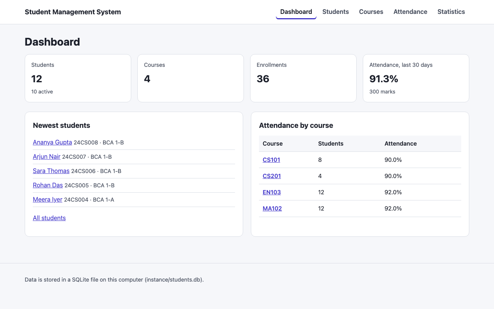

# Student Management System

Student Management System is a Python web application for keeping student records: students, courses, enrollments and attendance, with search, filters and statistics. It is built with Flask and stores everything in a SQLite database file on your own computer, so it needs no database server and no internet connection once installed.

| Project detail | Value                                                |
| -------------- | ---------------------------------------------------- |
| Institution    | _Add your institution_                               |
| Built by       | _Add your name_                                      |
| Template       | CampusKit `student-management-system`, version 1.0.0 |
| Stack          | Python 3.11+, Flask, SQLite, HTML and CSS            |



## Features

- **Students:** add, view, edit and delete students, with validation of every field and a confirmation page before anything is deleted.
- **Search, filter, sort and pages:** find students by name, roll number or email, filter by class and status, sort by name, roll number, class or admission date, and move through pages.
- **Courses:** add, edit and delete courses, and see who takes each one.
- **Enrollments:** enroll students in courses and remove them.
- **Attendance:** mark each student present, late or absent for a course on any day up to today, and change marks later.
- **Statistics:** students by status and class, and attendance per course, all calculated from the data when the page opens.
- **Safe by default:** CSRF protection on every form, SQL parameters for every query, escaped output, security headers, and the app only accepts connections from your own computer.
- **Sample data:** a fictional class of 12 students and 4 courses with two weeks of attendance, so the app has something to show on its first run.

## Prerequisites

- **Python 3.11 or newer.** Check with `python --version` (Windows) or `python3 --version` (macOS and Linux). Download it from <https://www.python.org/downloads/>; on Windows, tick “Add python.exe to PATH” while installing.
- A web browser.

## Getting started

Open a terminal in this folder, then create a virtual environment so the packages stay inside this project.

**Windows (PowerShell)**

```powershell
python -m venv .venv
.venv\Scripts\Activate.ps1
pip install -r requirements.txt
python run.py
```

**macOS / Linux**

```bash
python3 -m venv .venv
source .venv/bin/activate
pip install -r requirements.txt
python run.py
```

Then open <http://127.0.0.1:5000/> in your browser. Press `Ctrl+C` in the terminal to stop the app. Next time, activate the virtual environment again and run `python run.py`.

If PowerShell refuses to run the activation script, run `Set-ExecutionPolicy -Scope CurrentUser RemoteSigned` once and try again. If port 5000 is busy (on macOS, AirPlay Receiver uses it), start the app on another port: `$env:PORT=5050; python run.py` in PowerShell, or `PORT=5050 python run.py` on macOS and Linux.

## The database

The first time the app starts, it creates the database file `instance/students.db` and, unless `seed_demo_data` is `false` in `app_config.json`, fills it with the fictional sample data. Everything you add is saved in that file.

| Table         | What it holds                                                  |
| ------------- | -------------------------------------------------------------- |
| `students`    | One row per student: roll number, name, email, class, status   |
| `courses`     | One row per course: code, title, credits, description          |
| `enrollments` | Which student takes which course (a many-to-many relationship) |
| `attendance`  | One mark per student, course and day: present, late or absent  |

The full schema, with its constraints, is in `studentms/schema.sql`, and `docs/ARCHITECTURE.md` explains it. To look inside the file, open it with [DB Browser for SQLite](https://sqlitebrowser.org/).

These commands work with the virtual environment active:

```bash
flask --app studentms backup-db          # save a copy in instance/backups
flask --app studentms reset-db --yes     # back up, delete everything, add the sample data again
flask --app studentms reset-db --yes --empty   # the same, but leave the database empty
```

To restore a backup, stop the app, copy the backup file over `instance/students.db`, and start the app again. The `instance` folder is in `.gitignore`, so your data is never committed.

## Configuration

Change these in `app_config.json`, then restart the app:

| Setting             | Meaning                                                        |
| ------------------- | -------------------------------------------------------------- |
| `app_name`          | The name in the header and the browser tab                     |
| `institution_name`  | Shown under the name; leave it empty to hide it                |
| `author_name`       | Shown in the footer as “Built by …”; leave it empty to hide it |
| `students_per_page` | How many students each page of the list shows (5 to 50)        |
| `seed_demo_data`    | `true` fills a new, empty database with the sample data        |

How the app runs (its port, the database location and the secret key) can be set with environment variables or a `.env` file: copy `.env.example` to `.env` and read the comments in it. The accent colour is at the top of `studentms/static/style.css`.

## How it works

`run.py` calls `create_app()` in `studentms/__init__.py`, which loads the settings, prepares the database and registers the pages. Each request goes to a function in `studentms/views/`, which checks the input with `studentms/validation.py`, reads or writes the database through `studentms/repository.py`, and renders an HTML template from `studentms/templates/`. The pages need no JavaScript. `docs/ARCHITECTURE.md` follows a request through every step.

## Project structure

```text
run.py                    Starts the app
app_config.json           Settings you can change without editing code
studentms/
  __init__.py             create_app(): settings, database, security, pages
  config.py               Reads app_config.json, .env and the secret key
  db.py                   SQLite connection, schema set-up, sample data, commands
  schema.sql              Tables, relationships and constraints
  repository.py           Every SQL query
  validation.py           Checks for the forms
  security.py             CSRF protection and security headers
  views/                  The pages: dashboard, students, courses, attendance
  templates/              HTML (Jinja) templates
  static/style.css        Styles, including the accent colour
tests/                    pytest tests
docs/
  ARCHITECTURE.md         How the parts fit together
  VIVA_QUESTIONS.md       Questions you may be asked about this project
instance/                 Created on first run: the database, backups, secret key
```

## Testing

With the virtual environment active:

```bash
pip install -r requirements-dev.txt
python -m pytest
```

The tests use a temporary database. They cover every validation rule, configuration and `.env` loading, the queries (search, filters, sorting, pages, enrollments, attendance, statistics), constraints and cascading deletes, every page through Flask's test client (adding, editing and deleting students and courses, enrolling, marking attendance), the database commands, and security: CSRF tokens, escaping, SQL injection attempts and headers.

## Security notes

- Every form includes a CSRF token, and a POST without the right token is refused.
- Every SQL query passes values as parameters (`?`), so typed text can't change a query. Sorting uses a fixed list of columns.
- Jinja escapes everything it inserts into pages, so a name like `<script>` is shown as text.
- The session cookie is signed with a secret key kept in `instance/secret_key` (or `SECRET_KEY`), is hidden from scripts and isn't sent with requests from other sites.
- The app listens on `127.0.0.1`, so only your computer can open it. `python run.py` uses Flask's development server, which is fine for your own computer but not for a public website.
- Requests must use `127.0.0.1` or `localhost` in the address. That blocks _DNS rebinding_, a trick that lets a website reach apps running on your computer. If you set `HOST` to share the app on a network, any address is accepted.
- `FLASK_DEBUG=1` is refused unless `HOST` is `127.0.0.1` or `localhost`, because the debugger can run any code typed into an error page.

## Known limitations

- There is no login: anyone who can open the app can change the records. Add authentication before letting other people use it.
- It is designed for one person on one computer. SQLite handles that well; many simultaneous users would need a database server.
- Attendance has one mark per course per day, not per lecture.
- Times such as “Last updated” are shown in UTC.
- There are no imports or exports; back up by copying the database file.

## License and credits

This project is released under the MIT License (see [LICENSE](LICENSE)). It uses [Flask](https://flask.palletsprojects.com/) (BSD 3-Clause), which brings Werkzeug, Jinja, Click, ItsDangerous, MarkupSafe and Blinker (all BSD 3-Clause or MIT). The sample data is fictional. It was generated from the CampusKit `student-management-system` template. If you use it for coursework, follow your institution’s rules, mention that you started from a template, and make sure you can explain every part you present.
