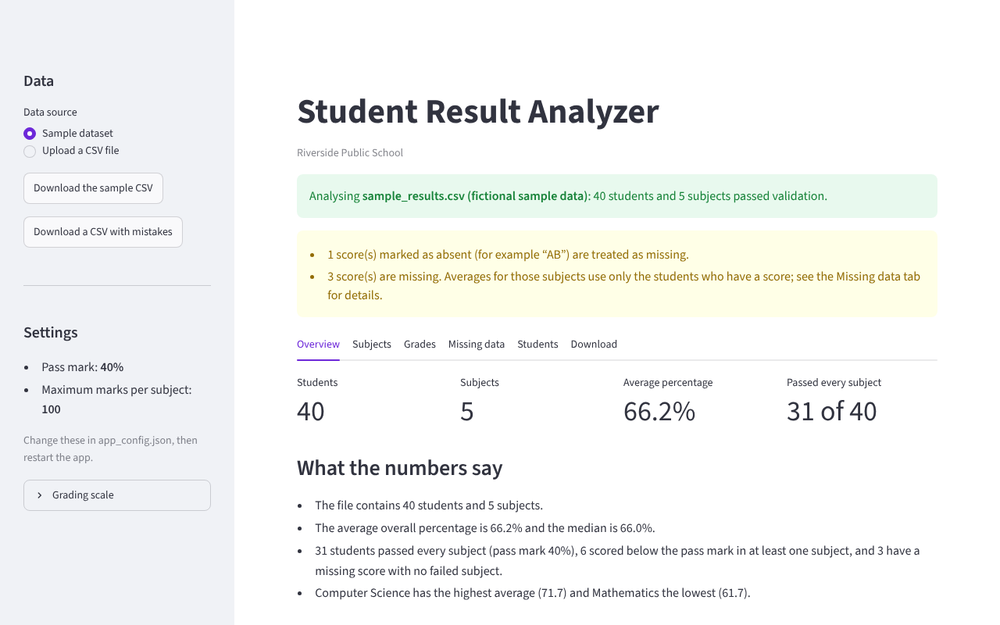
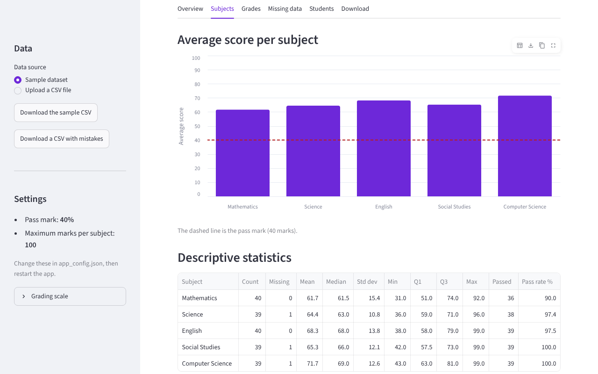
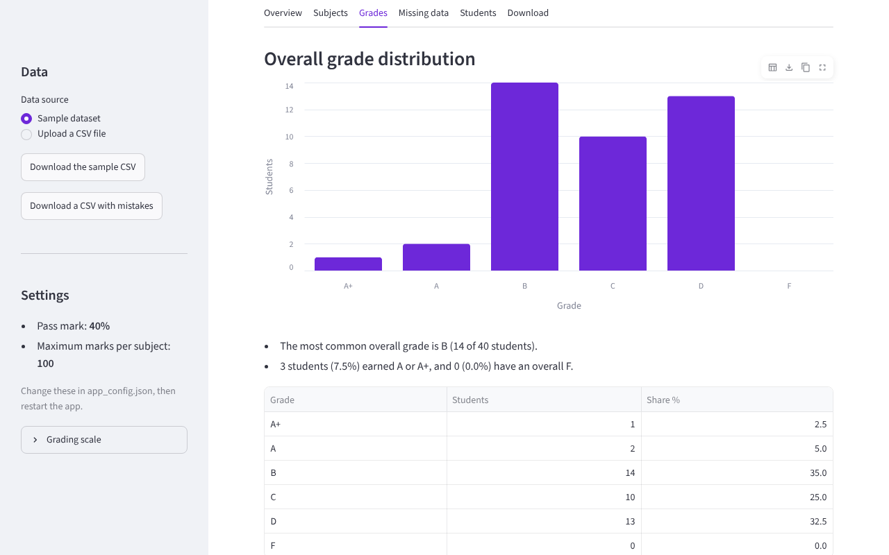

# Student Result Analyzer

Student Result Analyzer is a Python web app that turns a CSV file of exam marks into a clear report: descriptive statistics for every subject, grades and their distribution, pass/fail results, missing-score detection and plain-language explanations of what the numbers mean. It runs on your own computer with Streamlit; your data is not uploaded anywhere.

| Project detail | Value                                              |
| -------------- | -------------------------------------------------- |
| Institution    | Riverside Public School                            |
| Built by       | _Add your name_                                    |
| Template       | CampusKit `student-result-analyzer`, version 1.0.0 |
| Stack          | Python 3.11+, pandas, Streamlit, Altair            |



## Features

- **Sample dataset** of 40 fictional students in two classes, plus a file with deliberate mistakes to demonstrate validation.
- **CSV upload** with checks before any analysis: required columns, numeric scores, scores between 0 and the maximum, duplicate or empty student IDs, empty names, file size, encoding and malformed rows. Every problem is reported with its line number.
- **Descriptive statistics** per subject: count, missing, mean, median, standard deviation, minimum, quartiles, maximum and pass rate.
- **Student results:** total, percentage, grade, pass/fail/incomplete result, rank and the subjects below the pass mark.
- **Grade distribution** for the whole class and for any single subject, as charts and tables.
- **Missing-value detection:** empty cells and “AB”/“Absent” marks are counted per subject and per student, and left out of averages rather than treated as zero.
- **Plain-language explanations** generated from the actual results, and a glossary of every statistic.
- **Downloads:** student results and subject statistics as CSV, and a Markdown summary report.

| Subjects                                                          | Grades                                             |
| ----------------------------------------------------------------- | -------------------------------------------------- |
|  |  |

## Prerequisites

- **Python 3.11 or newer.** Check with `python --version` (or `python3 --version` on macOS/Linux). Download it from <https://www.python.org/downloads/>. On Windows, tick “Add python.exe to PATH” during installation.
- An internet connection for the first `pip install`. After that the app runs offline.

## Getting started

Open a terminal in this folder, then create a virtual environment so the packages stay inside this project:

**Windows (PowerShell)**

```powershell
python -m venv .venv
.venv\Scripts\Activate.ps1
pip install -r requirements.txt
streamlit run app.py
```

**macOS / Linux**

```bash
python3 -m venv .venv
source .venv/bin/activate
pip install -r requirements.txt
streamlit run app.py
```

Streamlit opens the app in your browser (usually at `http://localhost:8501`). Press `Ctrl+C` in the terminal to stop it. Next time, activate the virtual environment again and run `streamlit run app.py`.

If PowerShell refuses to run the activation script, run `Set-ExecutionPolicy -Scope CurrentUser RemoteSigned` once and try again.

## Preparing your own CSV file

The first row must contain column names. Required: **Student ID** and **Name**. Optional: **Class** (or **Section**). Every other column is treated as a subject:

```csv
Student ID,Name,Class,Mathematics,Science,English
S101,Asha Kumar,10-A,78,82,91
S102,Rahul Mehta,10-A,64,AB,72
```

- Column names are matched without caring about capitals or spaces (`student id`, `Roll No` and `Admission No` all work for the ID).
- Scores can have decimals. Leave a cell empty, or write `AB` / `Absent`, for a missing score.
- Save from Excel or Google Sheets as **CSV UTF-8** so names with accents or other scripts display correctly.
- Use **Download the sample CSV** in the sidebar to start from a correct template, or **Download a CSV with mistakes** to see the validation messages.

## Configuration

Edit `app_config.json`, then restart the app:

| Setting            | Meaning                                                               |
| ------------------ | --------------------------------------------------------------------- |
| `app_name`         | Title of the app and the downloaded report.                           |
| `institution_name` | Shown under the title. Leave empty (`""`) to hide it.                 |
| `author_name`      | Shown in the footer as “Built by …”. Leave empty to hide it.          |
| `pass_mark`        | Minimum percentage to pass a subject, a whole number from 30 to 60.   |
| `max_marks`        | Maximum marks per subject (10 to 1000). Scores above it are rejected. |

The accent colour is set by `primaryColor` in `.streamlit/config.toml`.

## How results are calculated

- **Percentage** = total of the subjects a student has scores for ÷ (number of those subjects × maximum marks) × 100.
- **Grades** use the percentage: A+ 90 and above, A 80–89.99, B 70–79.99, C 60–69.99, D from the pass mark to 59.99, F below the pass mark. Change the bands in `analyzer/grading.py`.
- **Result:** _Fail_ if any score is below the pass mark; otherwise _Incomplete_ if any score is missing; otherwise _Pass_.
- **Rank** orders students by percentage; equal percentages share a rank (1, 1, 3).
- **Statistics** skip missing scores, and the _Count_ column shows how many students each figure is based on. The standard deviation is the sample standard deviation.

## Project structure

```text
app.py                  Streamlit user interface (no calculations)
app_config.json         Settings you can change without editing code
analyzer/
  config.py             Reads and checks app_config.json
  validation.py         Loads the CSV and checks it
  grading.py            Grade bands
  analysis.py           Statistics, results, distributions, missing data
  explain.py            Plain-language explanations and glossary
  report.py             CSV and Markdown downloads
data/
  sample_results.csv    Fictional sample class
  sample_with_errors.csv  Example file with mistakes
tests/                  pytest tests, including a headless run of the app
docs/
  ARCHITECTURE.md       How the parts fit together
  VIVA_QUESTIONS.md     Questions you may be asked about this project
.streamlit/config.toml  Theme colour and Streamlit settings
```

## Testing

With the virtual environment active:

```bash
pip install -r requirements-dev.txt
python -m pytest
```

The tests check configuration loading, every validation rule (including line numbers, encodings and Unicode names), statistics against hand-calculated values, grade boundaries, results and ranks, missing-value detection, explanations, the CSV and Markdown downloads, and run the Streamlit app headlessly with `streamlit.testing`.

## Known limitations

- Each subject must use the same maximum marks; papers with different maximums need to be scaled first.
- Grades are based on percentages with fixed bands; credit-based GPA or CGPA systems are not implemented.
- The app analyses one file at a time and does not compare exams over time.
- Files are limited to 5 MB and 10,000 students.
- Uploaded files are processed in memory while the app runs and are not saved.
- There is no login. The app only accepts connections from your own computer (`address = "localhost"` in `.streamlit/config.toml`); if you remove that setting, anyone on the same network can open it while it runs.

## License and credits

This project is released under the MIT License (see [LICENSE](LICENSE)). It uses [Streamlit](https://streamlit.io/) (Apache 2.0), [pandas](https://pandas.pydata.org/) (BSD 3-Clause) and [Altair](https://altair-viz.github.io/) (BSD 3-Clause). The sample data is fictional. It was generated from the CampusKit `student-result-analyzer` template. If you use it for coursework, follow your institution’s rules, mention that you started from a template, and make sure you can explain every part you present.
